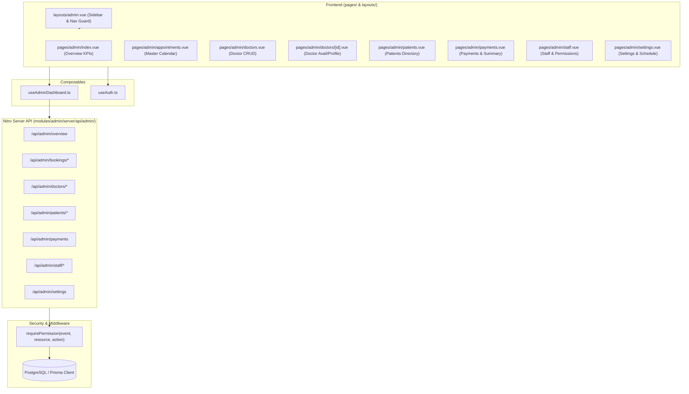

# Tawasul Academy — Admin Panel Audit & Assessment Report

**Date:** September 7, 2026  
**Audited Target:** Admin Panel (Module: `modules/admin/`, Pages: `pages/admin*`, Layout: `layouts/admin.vue`, APIs: `modules/admin/server/api/admin/`)  
**Status:** Functional backend (100% test pass rate), but **1 Critical Routing Bug** blocks sub-page navigation, with several security loopholes and deviations from the Phase 6 specification.

---

## 1. Executive Summary

A comprehensive architectural, functional, security, and test audit was conducted on the Tawasul Academy Admin Panel.

### Key Highlights
- **All 44 Backend API Tests Pass** ([`tests/api/admin/`](file:///run/media/abdelrhman/ce5c2321-cae0-41d0-8d0b-4f69e26612db/ahmed%20projects/Tawasul/tests/api/admin)): The Nitro endpoints for doctor CRUD, staff management, appointment assignment/cancellation, payment reporting, schedule slots, and blocked dates are robust and functional.
- **Critical Frontend Routing Blocker Discovered**: Because `pages/admin.vue` exists at the root of `pages/` without a `<NuxtPage />` outlet, Nuxt 3 treats all files in `pages/admin/*.vue` as child routes. As a result, visiting `/admin/appointments`, `/admin/doctors`, `/admin/patients`, `/admin/payments`, `/admin/staff`, or `/admin/settings` **fails to render the child pages** and permanently renders the overview page instead.
- **Security & Authorization Loopholes**:
  - Doctor deactivation updates `doctor.isActive` to `false`, but fails to set `user.isActive` to `false`. Consequently, deactivated doctors can still log in.
  - Staff update endpoint (`PATCH /api/admin/staff/:id`) does not protect the seed admin from deactivation or permission stripping (unlike `DELETE`).
  - Route middleware (`staff-only.ts`) only checks for `STAFF` account type, not individual per-page permissions (e.g. `DOCTORS:READ`).
- **Phase 6 Specification Parity**: The `/api/admin/overview` aggregation endpoint exists and is tested, but the frontend overview page displays schedule slots and blocked days instead of platform KPIs (revenue, confirmed bookings change, active patients, recent bookings). Calendar doctor color-coding and filter bars are also missing.

---

## 2. Identified Bugs & Vulnerabilities

| ID | Severity | Category | Description | Affected Files |
|---|---|---|---|---|
| **BUG-01** | 🚨 **CRITICAL** | Routing / Navigation | **Sub-pages unreachable**: Nuxt 3 nested route hierarchy causes `/admin/*` to always render [`pages/admin.vue`](file:///run/media/abdelrhman/ce5c2321-cae0-41d0-8d0b-4f69e26612db/ahmed%20projects/Tawasul/pages/admin.vue) rather than the child pages. | [`pages/admin.vue`](file:///run/media/abdelrhman/ce5c2321-cae0-41d0-8d0b-4f69e26612db/ahmed%20projects/Tawasul/pages/admin.vue), [`pages/admin/`](file:///run/media/abdelrhman/ce5c2321-cae0-41d0-8d0b-4f69e26612db/ahmed%20projects/Tawasul/pages/admin) |
| **SEC-01** | 🔴 **HIGH** | Authentication / AuthZ | **Deactivated doctors can still log in**: [`doctors/[id].patch.ts`](file:///run/media/abdelrhman/ce5c2321-cae0-41d0-8d0b-4f69e26612db/ahmed%20projects/Tawasul/modules/admin/server/api/admin/doctors/%5Bid%5D.patch.ts#L37-L39) updates `doctor.isActive`, but [`login.post.ts`](file:///run/media/abdelrhman/ce5c2321-cae0-41d0-8d0b-4f69e26612db/ahmed%20projects/Tawasul/modules/auth/server/api/auth/login.post.ts#L44) checks `user.isActive`. | [`doctors/[id].patch.ts`](file:///run/media/abdelrhman/ce5c2321-cae0-41d0-8d0b-4f69e26612db/ahmed%20projects/Tawasul/modules/admin/server/api/admin/doctors/%5Bid%5D.patch.ts) |
| **SEC-02** | 🔴 **HIGH** | Authorization / Access Control | **Seed admin can be disabled via PATCH**: [`staff/[id].delete.ts`](file:///run/media/abdelrhman/ce5c2321-cae0-41d0-8d0b-4f69e26612db/ahmed%20projects/Tawasul/modules/admin/server/api/admin/staff/%5Bid%5D.delete.ts#L18-L21) protects `SEED_ADMIN_EMAIL`, but [`staff/[id].patch.ts`](file:///run/media/abdelrhman/ce5c2321-cae0-41d0-8d0b-4f69e26612db/ahmed%20projects/Tawasul/modules/admin/server/api/admin/staff/%5Bid%5D.patch.ts) allows setting `isActive: false` or clearing all permissions on the seed admin. | [`staff/[id].patch.ts`](file:///run/media/abdelrhman/ce5c2321-cae0-41d0-8d0b-4f69e26612db/ahmed%20projects/Tawasul/modules/admin/server/api/admin/staff/%5Bid%5D.patch.ts) |
| **SEC-03** | 🟡 **MEDIUM** | Frontend Route Guarding | **Page-level permission middleware missing**: [`middleware/staff-only.ts`](file:///run/media/abdelrhman/ce5c2321-cae0-41d0-8d0b-4f69e26612db/ahmed%20projects/Tawasul/middleware/staff-only.ts#L6-L8) only verifies `accountType === 'STAFF'`. Staff without `DOCTORS:READ` can navigate directly to `/admin/doctors` (the API returns 403, but page UI renders without redirection). | [`middleware/staff-only.ts`](file:///run/media/abdelrhman/ce5c2321-cae0-41d0-8d0b-4f69e26612db/ahmed%20projects/Tawasul/middleware/staff-only.ts), [`pages/admin/*.vue`](file:///run/media/abdelrhman/ce5c2321-cae0-41d0-8d0b-4f69e26612db/ahmed%20projects/Tawasul/pages/admin/) |
| **BUG-02** | 🟡 **MEDIUM** | Business Logic | **Cancellation refunds non-successful payments**: [`cancel.patch.ts`](file:///run/media/abdelrhman/ce5c2321-cae0-41d0-8d0b-4f69e26612db/ahmed%20projects/Tawasul/modules/admin/server/api/admin/bookings/%5Bid%5D/cancel.patch.ts#L34-L37) marks all payments where `status != 'REFUNDED'` as `REFUNDED`, even if the payment status was `PENDING` or `FAILED`. | [`cancel.patch.ts`](file:///run/media/abdelrhman/ce5c2321-cae0-41d0-8d0b-4f69e26612db/ahmed%20projects/Tawasul/modules/admin/server/api/admin/bookings/%5Bid%5D/cancel.patch.ts) |
| **WARN-01**| 🟢 **LOW** | Developer Experience / Build | **Duplicate utility imports**: Both [`server/utils/admin-availability.ts`](file:///run/media/abdelrhman/ce5c2321-cae0-41d0-8d0b-4f69e26612db/ahmed%20projects/Tawasul/server/utils/admin-availability.ts) and [`server/utils/availability.ts`](file:///run/media/abdelrhman/ce5c2321-cae0-41d0-8d0b-4f69e26612db/ahmed%20projects/Tawasul/server/utils/availability.ts) export `formatDateISO` and `timeToMinutes`, causing Nuxt compiler collision warnings. | [`server/utils/admin-availability.ts`](file:///run/media/abdelrhman/ce5c2321-cae0-41d0-8d0b-4f69e26612db/ahmed%20projects/Tawasul/server/utils/admin-availability.ts) |

---

## 3. Deep-Dive: Root Cause Analysis of BUG-01 (Nested Routing Blocker)

### The Problem
In Nuxt 3 (and Vue Router), having a file with the same name as a sibling folder triggers nested route generation:
```text
pages/
├── admin.vue          <-- Defines parent route "/admin"
└── admin/             <-- Defines children routes ("/admin/appointments", etc.)
    ├── appointments.vue
    ├── doctors.vue
    ├── patients.vue
    ├── payments.vue
    ├── settings.vue
    └── staff.vue
```
Vue Router configures this as:
```js
{
  path: '/admin',
  component: () => import('~/pages/admin.vue'),
  children: [
    { path: 'appointments', component: () => import('~/pages/admin/appointments.vue') },
    // ...
  ]
}
```
Because [`pages/admin.vue`](file:///run/media/abdelrhman/ce5c2321-cae0-41d0-8d0b-4f69e26612db/ahmed%20projects/Tawasul/pages/admin.vue) contains static overview cards rather than `<NuxtPage />`, Vue Router has no outlet to mount the child view. Navigating to any link (e.g. `/admin/doctors`) renders [`pages/admin.vue`](file:///run/media/abdelrhman/ce5c2321-cae0-41d0-8d0b-4f69e26612db/ahmed%20projects/Tawasul/pages/admin.vue), breaking the entire admin navigation.

### Verification
During live Playwright execution, testing `/admin/appointments` returned:
```text
appointments page title: Admin Overview
Expected: "Appointments"
```

### Solution
Follow the same convention used in `pages/dashboard/`:
1. Delete or rename [`pages/admin.vue`](file:///run/media/abdelrhman/ce5c2321-cae0-41d0-8d0b-4f69e26612db/ahmed%20projects/Tawasul/pages/admin.vue) to `pages/admin/index.vue` (or create `pages/admin/overview.vue` and redirect `/admin` to `/admin/overview`).
2. All pages in `pages/admin/` become flat sibling routes, properly rendered inside the layout outlet [`app.vue`](file:///run/media/abdelrhman/ce5c2321-cae0-41d0-8d0b-4f69e26612db/ahmed%20projects/Tawasul/app.vue).

---

## 4. Phase 6 Specification vs. Implementation Checklist

| Spec Requirement | Target Endpoint / UI | Current Implementation Status | Evaluation |
|---|---|---|---|
| Admin Dashboard Layout & Sidebar | [`layouts/admin.vue`](file:///run/media/abdelrhman/ce5c2321-cae0-41d0-8d0b-4f69e26612db/ahmed%20projects/Tawasul/layouts/admin.vue) | Responsive sidebar, desktop & mobile nav, user profile, logout, permission filtering (`hasPermission`) | ✅ **Compliant** |
| Permission check in DB per request | [`server/utils/permissions.ts`](file:///run/media/abdelrhman/ce5c2321-cae0-41d0-8d0b-4f69e26612db/ahmed%20projects/Tawasul/server/utils/permissions.ts) | Queries `prisma.permission.findMany` on each request, never cached in JWT | ✅ **Compliant** |
| Seed admin permissions | [`prisma/seed.ts`](file:///run/media/abdelrhman/ce5c2321-cae0-41d0-8d0b-4f69e26612db/ahmed%20projects/Tawasul/prisma/seed.ts) | 14 core permissions seeded for `SEED_ADMIN_EMAIL` | ✅ **Compliant** |
| Seed admin protection | [`modules/admin/server/api/admin/staff/`](file:///run/media/abdelrhman/ce5c2321-cae0-41d0-8d0b-4f69e26612db/ahmed%20projects/Tawasul/modules/admin/server/api/admin/staff) | Protected in `DELETE /api/admin/staff/:id`, but **vulnerable** in `PATCH /api/admin/staff/:id` | ⚠️ **Partial** |
| Overview API | [`overview.get.ts`](file:///run/media/abdelrhman/ce5c2321-cae0-41d0-8d0b-4f69e26612db/ahmed%20projects/Tawasul/modules/admin/server/api/admin/overview.get.ts) | Aggregate queries for confirmed bookings, monthly/total revenue, active users, 5 recent bookings | ✅ **Compliant** |
| Overview UI | [`pages/admin.vue`](file:///run/media/abdelrhman/ce5c2321-cae0-41d0-8d0b-4f69e26612db/ahmed%20projects/Tawasul/pages/admin.vue) | Displays active schedules, blocked days, pending bookings instead of platform stats and recent bookings table | ⚠️ **Deviation from Spec** |
| Master Calendar with FullCalendar | [`pages/admin/appointments.vue`](file:///run/media/abdelrhman/ce5c2321-cae0-41d0-8d0b-4f69e26612db/ahmed%20projects/Tawasul/pages/admin/appointments.vue) | FullCalendar month view, Month navigation, detail modal, cancel booking, assign doctor | ✅ **Compliant** |
| Calendar Doctor Color-Coding & Filters | [`pages/admin/appointments.vue`](file:///run/media/abdelrhman/ce5c2321-cae0-41d0-8d0b-4f69e26612db/ahmed%20projects/Tawasul/pages/admin/appointments.vue) | Color-codes by **status** (green/red/gray), not doctor palette; doctor dropdown filter missing | ⚠️ **Deviation from Spec** |
| Admin Cancel Booking without 24h limit | [`cancel.patch.ts`](file:///run/media/abdelrhman/ce5c2321-cae0-41d0-8d0b-4f69e26612db/ahmed%20projects/Tawasul/modules/admin/server/api/admin/bookings/%5Bid%5D/cancel.patch.ts) | No time restriction; sends cancellation email | ✅ **Compliant** |
| Manage Doctors CRUD | [`pages/admin/doctors.vue`](file:///run/media/abdelrhman/ce5c2321-cae0-41d0-8d0b-4f69e26612db/ahmed%20projects/Tawasul/pages/admin/doctors.vue) | Create with temporary password + welcome email, table view, search, edit modal, active toggle | ✅ **Compliant** (except `user.isActive` bug) |
| Doctor Availability & Block Slots | [`doctors/[id].vue`](file:///run/media/abdelrhman/ce5c2321-cae0-41d0-8d0b-4f69e26612db/ahmed%20projects/Tawasul/pages/admin/doctors/%5Bid%5D.vue) | Weekly availability table and blocked slots management for individual doctors | ✅ **Compliant** |
| Manage Patients & Detail | [`pages/admin/patients.vue`](file:///run/media/abdelrhman/ce5c2321-cae0-41d0-8d0b-4f69e26612db/ahmed%20projects/Tawasul/pages/admin/patients.vue), `[id].vue` | Search, patient table with session metrics, detail page with booking & payment tables | ✅ **Compliant** |
| Manage Payments & Summary | [`pages/admin/payments.vue`](file:///run/media/abdelrhman/ce5c2321-cae0-41d0-8d0b-4f69e26612db/ahmed%20projects/Tawasul/pages/admin/payments.vue) | 3 Stat cards, date range / doctor / status filters, desktop table & mobile cards | ✅ **Compliant** |
| Manage Staff & Permission Builder | [`pages/admin/staff.vue`](file:///run/media/abdelrhman/ce5c2321-cae0-41d0-8d0b-4f69e26612db/ahmed%20projects/Tawasul/pages/admin/staff.vue), [`PermissionBuilder.vue`](file:///run/media/abdelrhman/ce5c2321-cae0-41d0-8d0b-4f69e26612db/ahmed%20projects/Tawasul/modules/admin/components/PermissionBuilder.vue) | Full permission matrix (6 resources × 4 actions), create, edit replace permissions, deactivate | ✅ **Compliant** |
| Settings & Masked Payment Keys | [`pages/admin/settings.vue`](file:///run/media/abdelrhman/ce5c2321-cae0-41d0-8d0b-4f69e26612db/ahmed%20projects/Tawasul/pages/admin/settings.vue) | Masked with `****${last4}`, `****` ignored on patch, toggle to edit, weekly schedule & blocked dates | ✅ **Compliant** |

---

## 5. Architectural & Component Review



---

## 6. Recommended Action Plan

### Step 1: Fix Route Hierarchy (Immediate)
- Rename [`pages/admin.vue`](file:///run/media/abdelrhman/ce5c2321-cae0-41d0-8d0b-4f69e26612db/ahmed%20projects/Tawasul/pages/admin.vue) to `pages/admin/index.vue`.
- Update the content of `pages/admin/index.vue` to call `fetchOverview()` and render the 4 Phase 6 KPI cards (Total Bookings, Total Revenue EGP, Active Patients, Active Doctors) along with the Recent Bookings table.

### Step 2: Fix Security Vulnerabilities
1. In [`modules/admin/server/api/admin/doctors/[id].patch.ts`](file:///run/media/abdelrhman/ce5c2321-cae0-41d0-8d0b-4f69e26612db/ahmed%20projects/Tawasul/modules/admin/server/api/admin/doctors/%5Bid%5D.patch.ts):
   Add `isActive: isActive ?? undefined` to `prisma.user.update` so that deactivating a doctor also updates `User.isActive` and denies login access.
2. In [`modules/admin/server/api/admin/staff/[id].patch.ts`](file:///run/media/abdelrhman/ce5c2321-cae0-41d0-8d0b-4f69e26612db/ahmed%20projects/Tawasul/modules/admin/server/api/admin/staff/%5Bid%5D.patch.ts):
   Add a guard forbidding changes to `isActive: false` or clearing permissions when `target.email === process.env.SEED_ADMIN_EMAIL`.
3. In [`modules/admin/server/api/admin/bookings/[id]/cancel.patch.ts`](file:///run/media/abdelrhman/ce5c2321-cae0-41d0-8d0b-4f69e26612db/ahmed%20projects/Tawasul/modules/admin/server/api/admin/bookings/%5Bid%5D/cancel.patch.ts):
   Change `status: { not: 'REFUNDED' }` to `status: 'SUCCESS'` when updating payments to `REFUNDED`.

### Step 3: Frontend Route Guards
- Create a route middleware or page guard checking `hasPermission(resource, 'READ')` on individual admin pages so unauthorized staff are redirected to `/admin` rather than seeing a 403 error inside an empty template.

### Step 4: Resolve Import Warnings
- In [`server/utils/admin-availability.ts`](file:///run/media/abdelrhman/ce5c2321-cae0-41d0-8d0b-4f69e26612db/ahmed%20projects/Tawasul/server/utils/admin-availability.ts), import `formatDateISO` and `timeToMinutes` from `~/server/utils/availability` rather than redefining them.
